## A brief introduction

::: {.bio-grid}
::: {}
::: {.bio-mark}
DB
:::
:::

::: {}
**Damian W. Betebenner, Ph.D.**

National Center for the Improvement of Educational Assessment

- Developer of the Student Growth Percentile methodology — the Colorado Growth Model — now used by education systems across the United States
- Author of the `SGP` R package, the open implementation of that work
- Adviser to states and large systems on using growth, not only achievement, for performance management

The views today are mine. They are offered as a conversation with DoWEA leadership, not as an audit of DoWEA schools.
:::
:::

::: {.notes}
Keep this short. The audience is executives, not a TAC. Offer to stay after for technical questions. Edit this slide if you want a headshot or a different affiliation line.
:::

## How this session is organized {.center}

::: {.visually-hidden}
Roadmap
:::

::: {style="font-size: 1.1em;"}
1. **What student growth is about** — a picture, not a formula
2. **Death to proficiency. Long live proficiency.** — why status alone is a poor management tool
3. **Norm and criterion** — how much did they grow, and is it enough?
4. **DoWEA status and growth** — NAEP achievement, and a first look at cohort growth
5. **Growth for process management** — finding pockets of strength and weakness
6. **Questions**
:::

::: {.fine-print}
AI systems assisted in preparing this deck. Every number is tied to a cited public source or to labeled illustrative data. Responsibility for the claims remains with the author.
:::

::: {.notes}
Forty-five minutes plus questions. Part 1 is visual. Part 4 is the DoWEA payoff. Part 5 uses illustrative data — say that out loud when we get there.
:::

# What student growth is about {.center}

::: {.visually-hidden}
Section: what growth is
:::

## Status: snapshots in time

::: {.fragment .visually-hidden}
A cohort starts Grade 3 in August 2025
:::
::: {.fragment .visually-hidden}
Students learn across the Grade 3 year
:::
::: {.fragment .visually-hidden}
Spring 2025 snapshot: status, what students know and can do at a fixed point in time
:::
::: {.fragment .visually-hidden}
Students move to Grade 4 for 2025–26
:::
::: {.fragment .visually-hidden}
Spring 2026 snapshot: status again
:::

::: {.notes}
Set up the picture before anything moves: time runs left to right, grade runs bottom to top. Each box is one school year, August to May.

Advance. A cohort starts Grade 3 in August 2025. Advance. They learn across the year, and they spread out, because they do not all learn the same things. Advance. Before they leave in the spring we take a snapshot. That snapshot is status: what students know and can do at a fixed point in time. Advance. Over the summer they move up a grade, up and to the right, and spend the year in Grade 4. Advance. Another spring, another snapshot. Status again: what they know and can do in spring 2026.

Snapshots are necessary. They are not the learning. The same picture holds in every DoWEA school, whether in Virginia, Germany, or Japan.
:::

## Growth: learning between the snapshots

::: {.fragment .visually-hidden}
Growth: the change in what students know and can do across time
:::
::: {.fragment .visually-hidden}
Colored by growth percentile
:::
::: {.fragment .visually-hidden}
Status compares a row; growth follows the diagonal
:::

::: {.notes}
Same two snapshots. Advance. Now draw what happened between them: each line is one student, from where they stood in spring 2025 to where they stood in spring 2026. That flow is growth: the change in what students know and can do across time. Hold the two definitions side by side — status is a fixed point in time; growth is change across time.

Advance. Color each line by how that student's progress compares with peers who started in the same place. Blue: more growth than most of those peers. Red: less. Grey: typical. That is a growth percentile, and we will come back to it.

Advance. This is the key contrast. Status systems compare Grade 4 this year with Grade 4 last year — the top row — which means comparing different groups of students. Growth follows the diagonal: the same students, followed over time. Both matter. They answer different questions.
:::

## {.center}

::: {.visually-hidden}
The sentence
:::

::: {.quote-hero}
Learning is a process. 
Education is the system designed to support it. 
Student growth is how we know whether that system is working.
:::

::: {.notes}
Let this sit. It is the thesis of the hour. Everything after this is in service of it.
:::

# Death to proficiency. Long live proficiency. {.center}

::: {.visually-hidden}
Section: proficiency
:::

## Status-based systems are poor performance-management tools

::: {.columns}
::: {.column width="52%"}

We live in a culture that loves **ends** and neglects **means**.

- I want to be successful.
- I want to win.
- I want proficiency rates to go up.

Accountability systems built on a single status number ask schools to produce an outcome without describing the process that produces it.

:::
::: {.column width="46%"}

::: {.warning-box}
::: {.warning-box-title}
The management error
:::
Telling a school to "raise proficiency" is like telling a team to "win more." It names the scoreboard. It does not name the work.
:::

:::
:::

::: {.notes}
This is the WERA argument, trimmed. Do not spend time on NCLB history. Executives already know the scoreboard. They need permission to look at the process.
:::

## What sports teach about accountability

::: {.incremental}
- A coach is judged on wins and losses. That will not change.
- Good coaches do not tell players to "win more." They install a process.
- If everyone plays their role, the team has the best chance of winning.
- In education, wins and losses are proficient and not proficient.
- "Raise proficiency rates" is the forced shot — an ill-advised play, written as policy.
:::

::: {.notes}
One beat per bullet. Then the next slide names the rational-but-maladaptive response.
:::

## The rational, maladaptive response

::: {.quote-hero}
Focus on the bubble kids.
:::

::: {.key-insight}
A status-only scoreboard makes it rational to spend the year on students just below the cut. That is the educational version of the forced shot. It can move the number. It is not a process for learning.
:::

::: {.notes}
Say this with respect. Leaders who did this were responding to the system they were given. The fix is a better instrument, not a lecture about character.
:::

## Wear two hats

:::: {.v-center-cols}
::: {.columns}
::: {.column width="42%"}

**Hat 1 — Accountability.** Proficiency is what you are ultimately responsible for. A system where few students are proficient is not healthy, whatever else is true.

**Hat 2 — Management.** Effective performance management focuses on process. That is the hat you wear on Tuesday morning.

:::
::: {.column width="56%"}

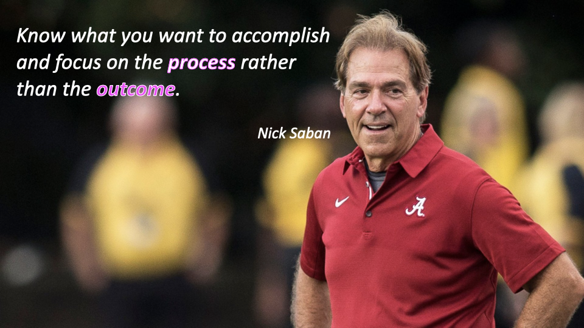{width="100%" fig-alt="Nick Saban quote: know what you want to accomplish and focus on the process rather than the outcome."}

:::
:::
::::

::: {.notes}
Long live proficiency: this is the turn. Do not over-explain Saban. The room will get it. The two-hat line is the one to land: you are responsible for proficiency; you manage growth.
:::

## Growth and status are opposite sides of the same coin

:::: {.v-center-cols}
::: {.columns}
::: {.column width="40%"}

Where a student is today depends on **where they started** and **how quickly they traveled**.

Distance = Rate × Time

- **Growth** is the leading indicator — the rate
- **Status** is the lagging indicator — the distance

If you care about achievement, you already care about growth. You may not be watching it yet.

:::
::: {.column width="58%"}

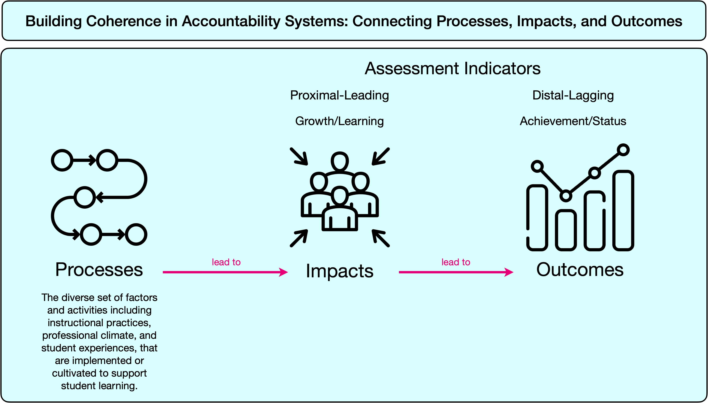{width="100%" fig-alt="Infographic ordering processes, impacts, and outcomes, with growth as the leading indicator and status as the lagging indicator."}

:::
:::
::::

::: {.notes}
Point at the infographic: growth sits between process and outcome. The common mistake — and experts make it — is to wire outcomes straight back to process and skip the growth in between.
:::

# Norm and criterion {.center}

::: {.visually-hidden}
Section: norm and criterion
:::

## Two ways of understanding the world

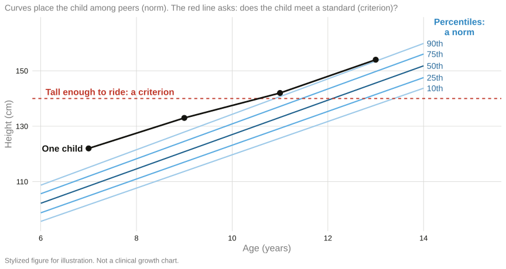{fig-alt="Stylized pediatric height chart with percentile curves and a red criterion line labeled tall enough to ride."}

::: {.notes}
Parents already know this. The percentile answers "where is my child among children this age?" The red line answers "can they ride the ride?" A complete picture needs both. Neither is the enemy of the other.
:::

## An inch is not always an inch

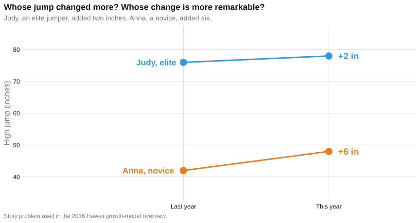{fig-alt="Judy the elite jumper gains two inches; Anna the novice gains six inches."}

::: {.notes}
Judy +2, Anna +6. Who improved more? Whose change is more remarkable? Scale-score gains have the same problem: low-achieving students often gain more points. Raw change without context misleads. That is why we use peers.
:::

## A complete understanding requires both

::: {.columns}
::: {.column width="50%"}

**Norm-referenced.** Where does this observation sit in a distribution of similar observations?

**Criterion-referenced.** Where does this observation sit relative to a standard we care about?

:::
::: {.column width="48%"}

::: {.key-insight-box}
::: {.key-insight-box-title}
For student growth
:::
**How much did the student grow?** — among academic peers.

**Is it enough?** — relative to a proficient (or college-ready, or on-track) standard.
:::

:::
:::

::: {.notes}
Do not let this become a methods seminar. Two questions. Two instruments. Both.
:::

## Student Growth Percentiles: how much did they grow?

::: {.fragment .visually-hidden}
One band of academic peers
:::
::: {.fragment .visually-hidden}
Locate one student among those peers
:::

::: {.notes}
Back to our cohort, colored by growth. Advance. Pick the students who started in the same place in spring 2025 — academic peers. Same starting point, but they do not all finish in the same place in spring 2026. Advance. A growth percentile locates one student in that fan. Fifty is typical. This student's percentile means they grew as much as or more than that share of their peers. That is the whole idea.
:::

## Percentile growth trajectories: is it enough?

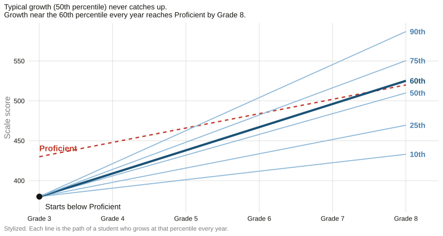{fig-alt="Percentile growth trajectories from one Grade 3 starting score below Proficient. Typical growth never reaches the rising Proficient line by Grade 8; growth near the 60th percentile every year reaches it by Grade 8, and higher percentiles reach it sooner."}

::: {.notes}
One student, starting below Proficient in Grade 3. Each line is where they would be if they grew at that percentile every year. Typical growth — the 50th — keeps them below the line. About the 60th percentile each year gets them there by Grade 8; the 90th gets them there by Grade 6. That is a percentile growth trajectory: how much growth (norm) is enough (criterion). Norm plus criterion, on the same picture.
:::

## Growth and system status

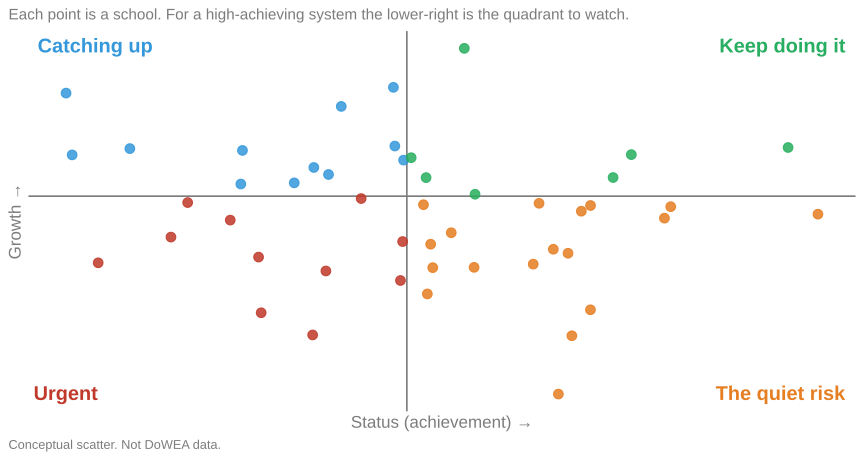{fig-alt="Conceptual four-quadrant scatter of status versus growth."}

::: {.notes}
Upper right: keep doing it. Upper left: the hopeful quadrant — catching up. Lower left: urgent. Lower right: the quiet risk for a high-achieving system — students who are already high and not learning much. DoWEA, by status, lives on the right-hand side. The open question is the vertical axis.
:::

# DoWEA status and growth {.center}

::: {.visually-hidden}
Section: DoWEA
:::

## DoWEA students are high achieving

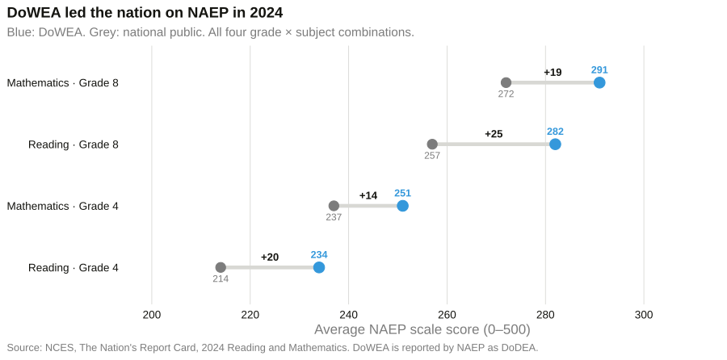{fig-alt="Dumbbell chart of 2024 NAEP average scale scores, DoWEA versus national public, for mathematics and reading in grades 4 and 8."}

::: {.notes}
First in the nation, again, on all four NAEP grade-by-subject combinations. Grade 4 math 251 versus 237. Grade 8 math 291 versus 272. Grade 4 reading 234 versus 214. Grade 8 reading 282 versus 257. Fourteen to twenty-five points above national public. Credit the system. Then turn the question.
:::

## The gap is not only the average

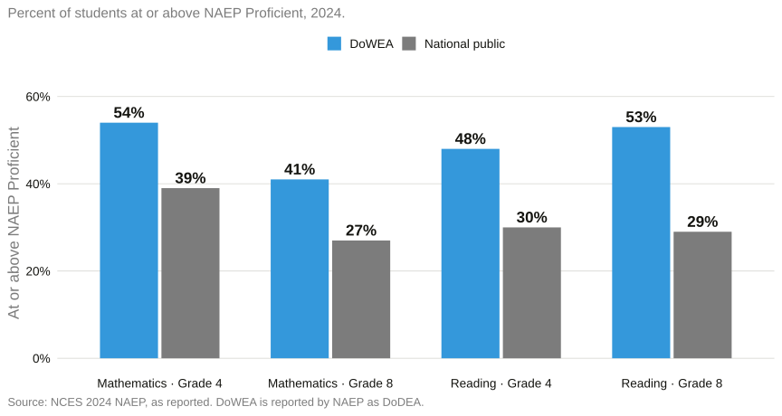{fig-alt="Bar chart of percent at or above NAEP Proficient in 2024, DoWEA versus national public: Grade 4 math 54 versus 39, Grade 8 math 41 versus 27, Grade 4 reading 48 versus 30, Grade 8 reading 53 versus 29."}

::: {.notes}
Proficient: G4 math 54 vs 39; G8 math 41 vs 27; G4 reading 48 vs 30; G8 reading 53 vs 29. Roughly half of DoWEA students are proficient, against roughly a third nationally.
:::

## Steady through the pandemic years

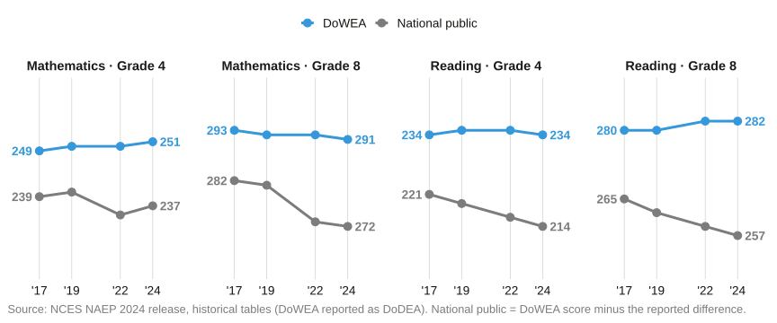{.r-stretch fig-alt="Four panels, 2017 to 2024, DoWEA versus national public NAEP averages. DoWEA is flat in every panel; national public declines in every panel."}

::: {.key-insight}
DoWEA held steady from 2017 to 2024 while national averages fell. That is a status success. It still does not answer whether students are **learning a lot**.
:::

::: {.notes}
Every panel has the same 40-point vertical span, so the slopes compare fairly. DoWEA is flat; the nation fell, most sharply in Grade 8 math (282 to 272). High status can hide slow growth. That is the hinge.
:::

## {.center}

::: {.visually-hidden}
The DoWEA question
:::

::: {.quote-hero}
Our students are high achieving. 
But are they learning a lot?
:::

::: {.notes}
This is the question DoWEA leadership is already asking. You are not bringing them a problem they have not noticed. You are bringing an instrument.
:::

## How to read a growth number from NAEP

::: {.columns}
::: {.column width="54%"}

NAEP does not follow the same students from Grade 4 to Grade 8. It takes two snapshots of different samples from the same cohort — here, Grade 4 in 2015 and Grade 8 in 2019, mathematics.

Recent work with Henry Braun estimates **cohort growth** from those two snapshots. It borrows the link between Grade 4 and Grade 8 scores from states that do follow individual students.

The result is a **mean SGPc**: the average growth percentile of a jurisdiction's students against **national academic peers**.

:::
::: {.column width="44%"}

::: {.theorem-box}
::: {.theorem-box-title}
A mean of 50
:::
The jurisdiction's students progressed, on average, as their national peers did from the same Grade 4 starting points.
:::

::: {.key-insight}
**DoWEA: 54.1** — seventh of 52 jurisdictions, in the **very high** group. On average, DoWEA students finished Grade 8 at the 54th percentile of national peers who started Grade 4 in the same place. (NAEP reports DoWEA as DoDEA.)
:::

:::
:::

::: {.notes}
Credit Braun. Emphasize: no student records were used. Pseudo-cohort. Relative to the nation in the same years — if everyone grew more, 54.1 would not change. Sampling interval 51.2–57.1. Outer band 45.1–63.1 once recovery error is included. Do not oversell precision.
:::

## DoWEA growth among the highest in the nation

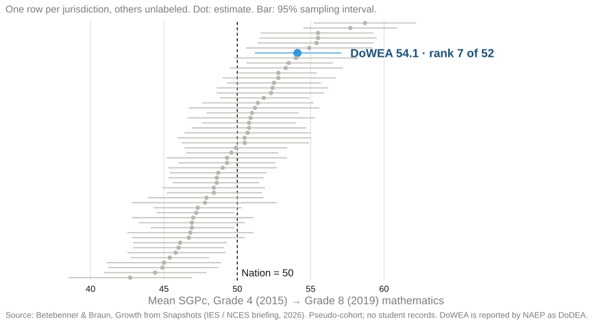{fig-alt="Dot plot of mean SGPc for 52 jurisdictions, Grade 4 2015 to Grade 8 2019 mathematics. Only DoWEA is labeled; it sits in the leading group."}

::: {.notes}
Other jurisdictions are deliberately unlabeled. The range runs from about 43 to 59; DoWEA is in the leading group. Most jurisdictions are indistinguishable from the nation. Name the good news, then the caveat: this is one cohort, one subject, four years, relative to the nation.
:::

## High status and high growth

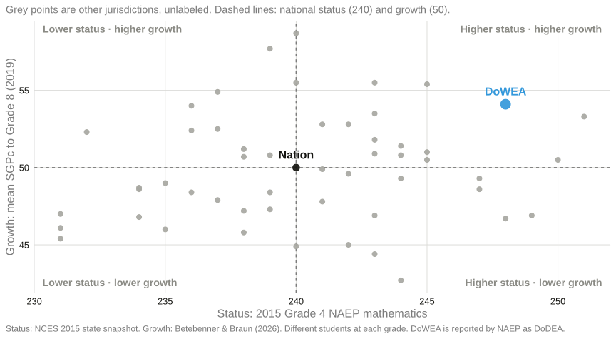{fig-alt="Scatter of 2015 Grade 4 NAEP mathematics status against mean SGPc for unlabeled jurisdictions, with DoWEA labeled in the high-status high-growth quadrant."}

::: {.notes}
This is the quadrant they care about. Upper right: high status and high growth. Lower right: high status but below-typical growth — high achievement can hide slow learning. Upper left: lower status but strong growth. DoWEA is high on both. Potential good news — say "potential." Composition change, mobility, and recovery error all remain.
:::

## Comparisons require a common test

Each step up trades local fit for wider comparison.

::: {.ladder}
::: {.ladder-rung .rung-3}
::: {.rung-title}
National assessment
:::
**NAEP.** Compares every participating jurisdiction — DoWEA, each state, and the nation.
:::
::: {.ladder-rung .rung-2}
::: {.rung-title}
Consortium assessment
:::
**Smarter Balanced and similar.** Compares the members that share the test.
:::
::: {.ladder-rung .rung-1}
::: {.rung-title}
Unique assessment
:::
**DoWEA CCRS summative (grades 3–7).** Compares DoWEA schools and students with one another.
:::
:::

::: {.key-insight}
DoWEA's CCRS summative assessments are the right instrument **inside** the system. NAEP is the bridge **across** systems.
:::

::: {.notes}
Greater standardization leads to greater generalizability. Do not apologize for uniqueness. Just be precise about what each assessment can say: you cannot compare a unique test with a state that does not take it. If they want school-level growth, that lives on the CCRS / longitudinal side, not on NAEP.
:::

# Growth for process management {.center}

::: {.visually-hidden}
Section: process management
:::

## Same proficiency, different learning

::: {.illustrative-badge}
Illustrative data — not DoWEA results
:::

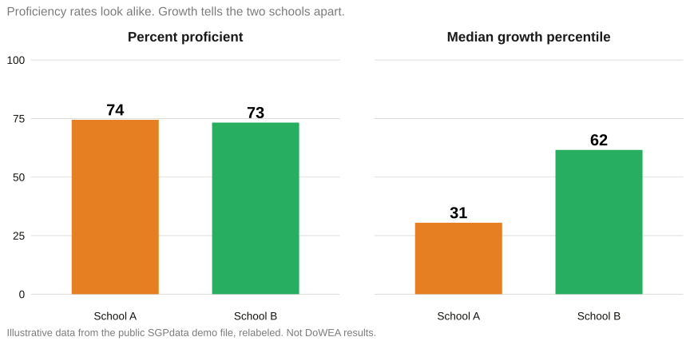{.r-stretch fig-alt="Two schools with similar proficiency rates and very different median growth percentiles."}

::: {.notes}
Say "illustrative" immediately. Public demo data, relabeled. The move is conceptual: two schools a status system cannot tell apart. Growth can. That is why growth belongs in the Tuesday meeting, not only in the June report.
:::

## Pockets of strength and weakness

::: {.illustrative-badge}
Illustrative data — not DoWEA results
:::

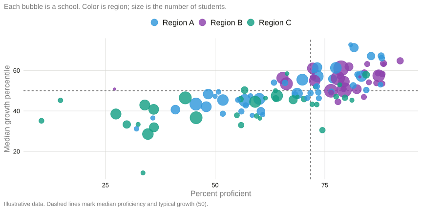{.r-stretch fig-alt="School-level bubble chart of percent proficient versus median growth percentile, colored by region."}

::: {.notes}
Each bubble is a school. Color is region; the regions are lettered on purpose so no one reads a real DoWEA region into demo data. Look for clusters above and below 50. That is where a leader spends time.
:::

## Region, then district, then school

::: {.illustrative-badge}
Illustrative data — not DoWEA results
:::

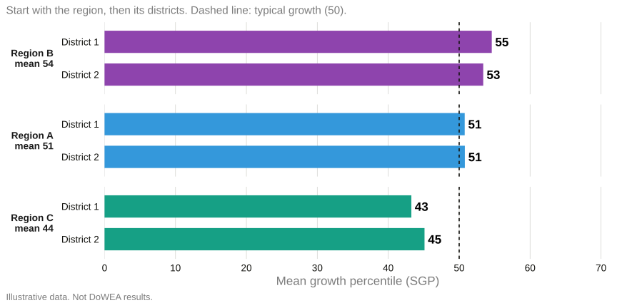{.r-stretch fig-alt="Median growth percentile for districts grouped by region, with each region's median shown beside its group."}

::: {.notes}
Do not start at the school. Start at the region, then the district or installation, then the school. The point is a drill-down habit, not these particular bars.
:::

## Are the highest achievers still learning a lot?

::: {.illustrative-badge}
Illustrative data — not DoWEA results
:::

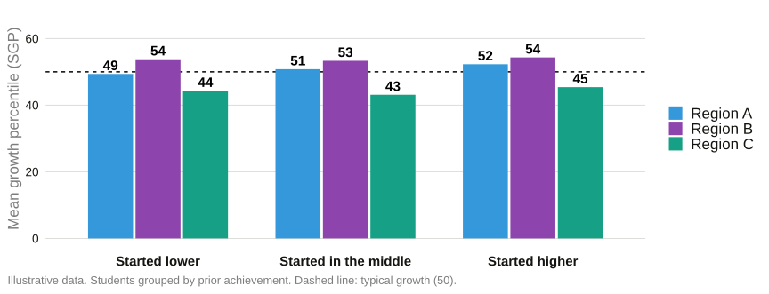{.r-stretch fig-alt="Median growth percentile by prior-achievement band and region."}

::: {.key-insight}
Status can look excellent while students who already sit high are coasting — or while students who sit low are not catching up.
:::

::: {.notes}
For a high-achieving system this is the diagnostic question, and the slide that should make DoWEA lean in. High status is not a guarantee of high growth at the top of the distribution.
:::

## Watch the process, not a single year

::: {.illustrative-badge}
Illustrative data — not DoWEA results
:::

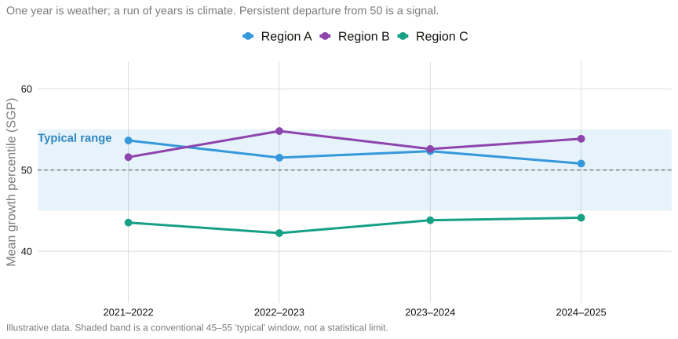{.r-stretch fig-alt="Median growth percentile over years by region, with a typical 45 to 55 band."}

::: {.notes}
Statistical process control, in plain language. One year is weather. A run of years is climate. Persistent departure from 50 is a signal worth a visit, not a verdict.
:::

## Questions a process-minded system asks

::: {.columns}
::: {.column width="52%"}

Not: *Who do we blame?*

Instead:

1. Where is growth strong — and what is happening there?
2. Where is growth weak for students who already sit high?
3. Where is growth weak for students who need to catch up?
4. What will we try, and how will we know in a year?

:::
::: {.column width="46%"}

::: {.key-insight-box}
::: {.key-insight-box-title}
DoWEA already has the language
:::
The 2026 Blueprint for Continuous Improvement is a process document. Growth is the pulse that tells you whether the blueprint is being felt in classrooms.
:::

:::
:::

::: {.notes}
Close the section by handing the instrument back to them. You are not installing a new accountability system. You are offering a way to watch the work they have already named.
:::

## Three things to leave with

1. **Proficiency is the destination.** It is what the public — and you — are responsible for. It is a poor tool for managing the work week to week.

2. **Growth is the pulse.** It tells you whether the process that produces proficiency is working — for students who start behind and for students who start ahead.

3. **DoWEA's status is not in doubt.** The first NAEP evidence on cohort growth is encouraging. The operational work is to watch growth **inside** the system, school by school, with the assessments you already give.

::: {.notes}
Read them. Do not add a fourth.
:::

## Questions {.center}

::: {.columns}
::: {.column width="58%"}

**Damian W. Betebenner** 
[dbetebenner@nciea.org](mailto:dbetebenner@nciea.org)

National Center for the Improvement of Educational Assessment

These slides: [dbetebenner.github.io/DoWEA_Presentation_102626](https://dbetebenner.github.io/DoWEA_Presentation_102626/)

NAEP growth work with **Henry I. Braun**, Lynch School of Education, Boston College.

:::
::: {.column width="40%"}

{width="70%" fig-alt="QR code linking to the public presentation."}

:::
:::

::: {.notes}
Stay for the specific questions: mobility, small n at a school, CCRS vs NAEP, whether SGPs can be run on DoWEA's own longitudinal files. Yes, they can, if unique student IDs persist across years.
:::
